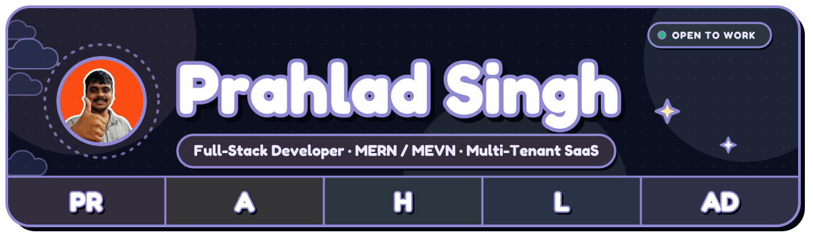
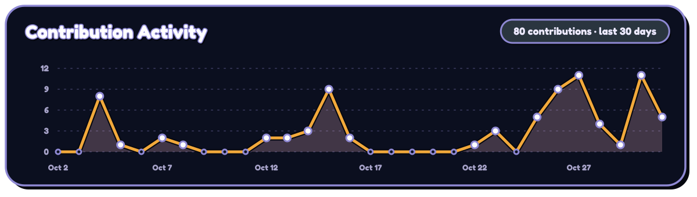
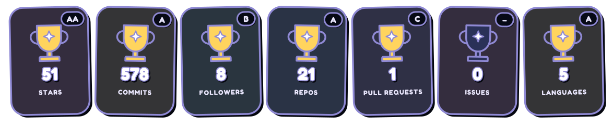
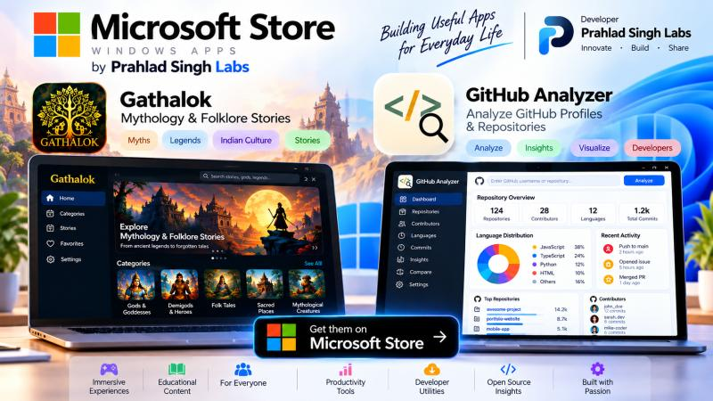
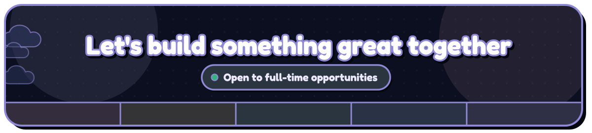

<picture>
    <source media="(prefers-color-scheme: dark)" srcset="https://readme-typing-svg.demolab.com?font=Fredoka&weight=600&size=24&duration=3000&pause=1000&color=dccfff&center=true&vCenter=true&width=700&lines=Hi+%F0%9F%91%8B+I'm+Prahlad+Singh;Full-Stack+Developer+(MERN+%2F+MEVN);Building+Multi-Tenant+SaaS+Architectures;Real-Time+Systems+%7C+Socket.io+%7C+PeerJS;Web+%7C+Mobile+%7C+Desktop+(Electron);JWT+%2F+RBAC+%7C+DevOps+on+Linux;Currently+%40+Lifelayer+Health+Solutions" />
    <source media="(prefers-color-scheme: light)" srcset="https://readme-typing-svg.demolab.com?font=Fredoka&weight=600&size=24&duration=3000&pause=1000&color=3d3560&center=true&vCenter=true&width=700&lines=Hi+%F0%9F%91%8B+I'm+Prahlad+Singh;Full-Stack+Developer+(MERN+%2F+MEVN);Building+Multi-Tenant+SaaS+Architectures;Real-Time+Systems+%7C+Socket.io+%7C+PeerJS;Web+%7C+Mobile+%7C+Desktop+(Electron);JWT+%2F+RBAC+%7C+DevOps+on+Linux;Currently+%40+Lifelayer+Health+Solutions" />
    
  </picture>

 

  

<picture>
    <source media="(prefers-color-scheme: dark)" srcset="https://readme-typing-svg.demolab.com?font=Fredoka&weight=600&size=17&duration=3000&pause=1000&color=dccfff&center=true&vCenter=true&width=700&lines=%F0%9F%94%AD+Working+on+a+large-scale+multi-tenant+healthcare+SaaS;%F0%9F%8C%B1+Shipping+web,+Android+%26+desktop+apps;%E2%9A%A1+Real-time+systems+with+Socket.io+++WebRTC;%F0%9F%9A%80+Everything+deployed+on+my+own+VPS" />
    <source media="(prefers-color-scheme: light)" srcset="https://readme-typing-svg.demolab.com?font=Fredoka&weight=600&size=17&duration=3000&pause=1000&color=3d3560&center=true&vCenter=true&width=700&lines=%F0%9F%94%AD+Working+on+a+large-scale+multi-tenant+healthcare+SaaS;%F0%9F%8C%B1+Shipping+web,+Android+%26+desktop+apps;%E2%9A%A1+Real-time+systems+with+Socket.io+++WebRTC;%F0%9F%9A%80+Everything+deployed+on+my+own+VPS" />
    
  </picture>

  
  

  

  

  <picture>
    <source media="(prefers-color-scheme: dark)" srcset="https://raw.githubusercontent.com/PrahladWebDev/PrahladWebDev/output/github-snake-night-dark.svg" />
    <source media="(prefers-color-scheme: light)" srcset="https://raw.githubusercontent.com/PrahladWebDev/PrahladWebDev/output/github-snake-night-dark.svg" />
    
  </picture>

  

  

  <picture>
    <source media="(prefers-color-scheme: dark)" srcset="https://readme-typing-svg.demolab.com?font=Fredoka&weight=600&size=16&duration=3000&pause=1000&color=bfeedd&center=true&vCenter=true&width=600&lines=git+commit+-m+%22ship+it%22;git+push+origin+main;pm2+restart+all;nginx+-t+%26%26+systemctl+reload+nginx;Deployment+completed+%E2%9C%85" />
    <source media="(prefers-color-scheme: light)" srcset="https://readme-typing-svg.demolab.com?font=Fredoka&weight=600&size=16&duration=3000&pause=1000&color=3d3560&center=true&vCenter=true&width=600&lines=git+commit+-m+%22ship+it%22;git+push+origin+main;pm2+restart+all;nginx+-t+%26%26+systemctl+reload+nginx;Deployment+completed+%E2%9C%85" />
    
  </picture>

 
<b>📦 Full Stack Breakdown</b>
  

| | |
|---|---|
| 🎨 **Frontend** | React.js · Vue.js · Next.js · React Native · Expo · Electron · Redux Toolkit · Vuex · TanStack Query / React Query · JavaScript (ES6+) · TypeScript · HTML5 · CSS3 · Tailwind CSS · Vuetify · Vite · Axios · Monaco Editor |
| ⚙️ **Backend** | Node.js · Express.js · NestJS · Java · Spring Boot · RESTful APIs · Socket.io · PeerJS · WebRTC · Redis · JWT · RBAC · PHP · Piston Code Execution API · Gemini API |
| 🗄️ **Database** | MongoDB · Mongoose · MySQL · Spring Data JPA · Multi-Tenant Database Architecture · MongoDB Atlas · Schema Design · Indexing · Aggregation Pipelines |
| 📡 **Real-Time & Communication** | Socket.io · WebSockets · PeerJS · WebRTC · Real-Time Notifications · User/Admin Namespaces · Room-Based Communication · QR/Code-Based Device Pairing |
| 🔐 **Authentication & Security** | JWT Authentication · Role-Based Access Control (RBAC) · OTP Verification · Password Hashing · Protected APIs · Secure File Sharing · Expiring Links |
| 🚀 **DevOps & Infrastructure** | Linux · Nginx · PM2 · GitHub Actions · CI/CD · Git · GitHub · SSH · SCP · SSL/TLS · Let's Encrypt · VPS Deployment · DNS · Domain & Subdomain Configuration |
| 📱 **App Publishing** | Google Play Store · Microsoft Store · Electron Desktop Builds · Android APK Builds (Expo) |
| 🧰 **Tools & Libraries** | Postman · Puppeteer · Cloudinary · Moment.js · Nodemailer · Brevo · Axios · Vue Toastification · React Query · Redux Toolkit · Vuex |
| 💳 **Payments & Media** | Razorpay · DICOM Medical Imaging · Video Streaming · File Uploads · Cloudinary · OTP-Based Media Access · Automated File Cleanup |
| ⏰ **Automation & Background Processing** | Node.js Cron Jobs · Scheduled Tasks · Automated Cleanup Engines · Notification Systems · Email Automation · Background Processing |
| 🤖 **AI & Developer Tools** | Google Gemini API · AI-Powered Summarization · AI Interview Assistance · AI Knowledge Extraction · Monaco Code Editor · Piston Code Execution |
| 🏗️ **Architecture & Engineering** | MERN · MEVN · Multi-Tenant SaaS Architecture · Modular Backend Architecture · REST API Design · Service-Based Architecture · Schema Design · API Integration · Real-Time Systems · Scalable Authentication Architecture |

  
  

  
  

  
  

  
  

| Project | Description | Links |
|---|---|---|
| 🎬 **Matinee** | Personal streaming site — your own media library with a clean, modern interface | [Repo](https://github.com/PrahladWebDev/matinee) |
| 🔐 **ShareVault** | Secure MERN file & video sharing platform — expiring links, OTP verification, admin Video Vault, automated cleanup engine | [Live](https://sharevault.prahladsingh.in/) · [Repo](https://github.com/PrahladWebDev/share-vault) |
| 🌍 **GathaLok** | World folklore & mythology platform (Web + Android + Windows/Electron) — 500+ stories, 20+ countries, contributor workflow, badges | [Live](https://gathalok.prahladsingh.in/) · [Microsoft Store](https://apps.microsoft.com/detail/9PP0R2RCS99W) · [Play Store](https://play.google.com/store/apps/details?id=com.gathalok.app&hl=en_IN) · [Web Repo](https://github.com/PrahladWebDev/gathalok) · [Mobile](https://github.com/PrahladWebDev/gathalok-app) · [Desktop](https://github.com/PrahladWebDev/gathalok-windows-mac) |
| 🏫 **School ERP** | Multi-tenant MERN school management system — academics, attendance, fees, real-time notifications with role-based dashboards | [Live](https://schoolerp.prahladsingh.in/) · [Repo](https://github.com/PrahladWebDev/school-erp-mern) |
| 👕 **Foldd - Wardrobe Manager** | React Native + Expo wardrobe app — cost-per-wear analytics, weather-aware outfits, packing lists | [Play Store](https://play.google.com/store/apps/details?id=com.wardrobemanager.app&hl=en_IN) · [Repo](https://github.com/PrahladWebDev/wardrobe-manager-react-native) |
| 🎲 **Random Person Picker** | React Native (Expo) random winner picker — add people with photos, import from contacts, saved lists, animated shuffle with sound & haptics | [Play Store](https://play.google.com/store/apps/details?id=com.prahlad.randompick&hl=en_IN) · [Repo](https://github.com/PrahladWebDev/random-person-picker) |
| 🎯 **GrabVid** | Terminal app to download videos from YouTube, X, Instagram & more — built with Ink (React for CLIs), 6 themes, format picker, live progress & history | [npm](https://www.npmjs.com/package/grabvid-cli) · [Repo](https://github.com/PrahladWebDev/grab-vid) |
| 🧩 **Zip Router** | MERN-stack puzzle game with procedural Hamiltonian-path level generator, server-side solution validation, star ratings, JWT auth | [Live](https://ziprouter.prahladsingh.in/) · [Repo](https://github.com/PrahladWebDev/zip-router) |
| 👾 **GitHub Personality Analyzer** | Full-stack app that generates a developer personality report — badges, language breakdown, commit heatmap, radar chart & Gemini AI summary + compare mode | [Live](https://ghanalyzer.prahladsingh.in/) · [Repo](https://github.com/PrahladWebDev/github-analyzer) |
| 🧠 **Brain Vault** | AI-powered knowledge management system — save URLs, let AI extract, summarize, tag, and connect them into an interactive Obsidian-style knowledge graph | [Live](https://brainvault.prahladsingh.in/) · [Repo](https://github.com/PrahladWebDev/brain-vault) |
| 💼 **InterviewVault** | AI-powered interview prep platform — Monaco editor, real code execution (Piston), spaced repetition, Gemini AI assistance, graph view, analytics | [Live](https://interviewvault.prahladsingh.in/) · [Repo](https://github.com/PrahladWebDev/interview-vault) |
| 📋 **Clipboard Cloud** | Instant cross-device clipboard sync — pair via QR or 6-digit code, real-time copy, optional account for permanent snippets | [Live](https://clipboard.prahladsingh.in/) · [Repo](https://github.com/PrahladWebDev/clipboard-cloud-) |
| 🧪 **Assessment Platform** | Proctored, timed exam platform with Monaco code editor, autosave, auto-submit + admin dashboard for question bank & live monitoring | [Live](https://admin.assessment.prahladsingh.in/) · [Repo](https://github.com/PrahladWebDev/assessment-platform) |
| 🕵️ **Codebase Detective** | Analyze your codebase — find hidden complexity and understand architecture | [Live](https://detective.prahladsingh.in/) · [Repo](https://github.com/PrahladWebDev/codebase-detective) |
| 💰 **Expense Tracker** | Full-stack expense tracker (Spring Boot 3 / Java 21 / MySQL + React 19 / TypeScript / Vite) — learning project with concept explanations | [Live](https://expensetracker.prahladsingh.in/) · [Repo](https://github.com/PrahladWebDev/expense-tracker-java) |
| 🤖 **Personal AI Agent** | Production-ready AI agent that knows and answers questions about one developer — skills, experience, projects | [Repo](https://github.com/PrahladWebDev/personal-ai-agent) |
| 🏫 **Vidya Setu** | MCA first project — admin/faculty portal for college outreach program (school visits, student counts, board type, progress tracking) | [Repo](https://github.com/PrahladWebDev/vidya-setu) |
| 🌐 **Portfolio** | Personal portfolio site showcasing projects and skills | [Live](https://prahladsingh.in/) · [Repo](https://github.com/PrahladWebDev/prahlad-singh-portfolio) |

  <picture>
    <source media="(prefers-color-scheme: dark)" srcset="./assets/prahlad-singh-labs-logo-dark.png" />
    <source media="(prefers-color-scheme: light)" srcset="./assets/prahlad-singh-labs-logo-light.png" />
    
  </picture>

<em>Ideas → Apps → Real Impact — Building Useful Apps for Everyday Life</em>

  

**Prahlad Singh Labs** is my independent developer label for publishing apps across stores — Innovate · Build · Share.

 

<table>
  <tr>
    <td width="50%" align="center">
      
    </td>
    <td width="50%" align="center">
      
    </td>
  </tr>
</table>

  
  
  
  

  <picture>
    <source media="(prefers-color-scheme: dark)" srcset="https://readme-typing-svg.demolab.com?font=Fredoka&weight=600&size=18&duration=3000&pause=1000&color=dccfff&center=true&vCenter=true&width=650&lines=%E2%9C%A8+Open+to+full-time+opportunities;Let's+build+something+great+together+%F0%9F%9A%80" />
    <source media="(prefers-color-scheme: light)" srcset="https://readme-typing-svg.demolab.com?font=Fredoka&weight=600&size=18&duration=3000&pause=1000&color=3d3560&center=true&vCenter=true&width=650&lines=%E2%9C%A8+Open+to+full-time+opportunities;Let's+build+something+great+together+%F0%9F%9A%80" />
    
  </picture>

